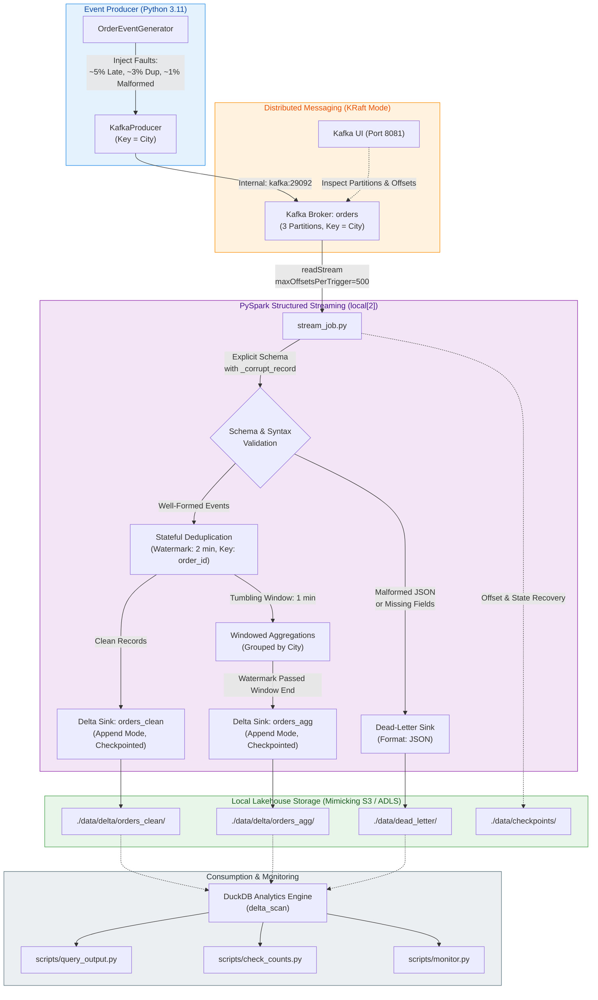

# Real-Time Orders Streaming Lakehouse (`realtime-orders-streaming`)

A production-grade, 100% local streaming pipeline processing simulated e-commerce and UPI order events. Built with **Apache Kafka (KRaft mode)**, **Apache Spark Structured Streaming (PySpark)**, **Delta Lake**, and **DuckDB**, orchestrated entirely within a single `docker-compose.yml`.

---

## Architecture Overview



---

## How It Runs Locally

Designed to run smoothly on standard laptops (e.g., 8 GB RAM, 4 CPU cores) with zero cloud dependencies:

| Container | Image | Purpose | Port / Resources |
| :--- | :--- | :--- | :--- |
| **`orders-kafka`** | `apache/kafka:3.7.1` | KRaft broker (no ZooKeeper), auto-creates topic `orders` with 3 partitions. Dual listeners. | `localhost:9092` (host), `kafka:29092` (internal) (~350 MB RAM) |
| **`orders-kafka-ui`**| `provectuslabs/kafka-ui:v0.7.2` | Web dashboard for inspecting topics, partitions, and live payloads. | [http://localhost:8081](http://localhost:8081) (~300 MB RAM) |
| **`orders-producer`**| `dataengineerproject2-producer` (Python 3.11-slim) | Generates UPI orders keyed by city with injected faults (~5% late, ~3% dup, ~1% malformed). | Internal (~20 MB RAM) |
| **`orders-spark`**   | `dataengineerproject2-spark` (Spark 3.5.1) | PySpark Structured Streaming engine in `local[2]` mode with Delta Lake 3.2.0. | Internal (~1.5 GB RAM) |

### Local Storage Layout (Standing in for S3 / ADLS)
All storage is mounted under `./data` on the host machine:
- `./data/delta/orders_clean/`: Bronze/Silver layer storing deduplicated, parsed valid orders in Delta format.
- `./data/delta/orders_agg/`: Gold layer storing 1-minute tumbling window metrics (revenue, order counts by status per city) in Delta format.
- `./data/dead_letter/`: Quarantined malformed or schema-violating payloads with diagnostic error reasons.
- `./data/checkpoints/`: Write-Ahead Log (WAL) and state stores for each streaming sink enabling fault-tolerant restart.

---

## Quickstart

### Prerequisites
- Docker Desktop installed and running.
- (Optional) Python 3.10+ on host if you wish to run scripts outside Docker.

### 1. Start Messaging Backbone
```bash
make up
```
Starts Kafka in KRaft mode, initializes the `orders` topic with 3 partitions, and launches Kafka UI at [http://localhost:8081](http://localhost:8081).

### 2. Start Event Producer
```bash
make produce
```
Begins publishing simulated orders across 10 Indian metros at 10 events/sec.

### 3. Start PySpark Streaming Pipeline
```bash
make stream
```
Launches Spark Structured Streaming in the background. It parses Kafka messages, routes bad records to `./data/dead_letter`, deduplicates valid orders, computes tumbling window metrics, and writes to Delta tables.

### 4. Query the Delta Lake & DLQ
```bash
make query
```
Runs `scripts/query_output.py` via DuckDB, displaying windowed revenue, city rankings, clean sample rows, and DLQ diagnostics.

### 5. Check Counts and Data Integrity
```bash
make counts
```
Runs `scripts/check_counts.py` to reconcile ingested messages, clean rows, distinct IDs, and quarantined faults.

### 6. View Live Operational Monitor
```bash
make monitor
```
Displays a live operational dashboard with throughput, revenue volume, and error capture statistics.

### 7. Run Unit Tests
```bash
make test
```
Executes pytest across both the event generator fault injectors and PySpark transformation functions.

### 8. Teardown & Clean
```bash
make down    # Stops containers cleanly
make clean   # Stops containers and purges local lakehouse data/checkpoints
```

---

## Live Output Samples

### 1. Live Deduplicated Micro-Batch (Console Sink)
```text
-------------------------------------------
Batch: 0
-------------------------------------------
+------------------------------------+--------+-------+---------+---------+--------------------------+---------------+------------+
|order_id                            |user_id |amount |city     |status   |event_time                |kafka_partition|kafka_offset|
+------------------------------------+--------+-------+---------+---------+--------------------------+---------------+------------+
|a3b9e3a9-3f4d-45e0-871b-b5904a23cb7f|usr_1904|3838.57|Jaipur   |PAID     |2026-10-15 21:08:54.317385|2              |0           |
|abca3de9-45eb-487c-9471-8f1644b5a519|usr_2449|3590.04|Ahmedabad|PAID     |2026-10-15 21:08:54.417772|2              |1           |
|e99d375d-8bdc-4bf7-b074-16d05c226a5f|usr_4884|1329.78|Ahmedabad|PAID     |2026-10-15 21:08:54.919608|2              |2           |
+------------------------------------+--------+-------+---------+---------+--------------------------+---------------+------------+
```

### 2. 1-Minute Tumbling Window Aggregations (Delta Lake)
```text
┌─────────────────────┬─────────────────────┬───────────┬──────────────┬───────────────┬─────────────┬────────────────┐
│    window_start     │     window_end      │   city    │ total_orders │ total_revenue │ paid_orders │ created_orders │
│      timestamp      │      timestamp      │  varchar  │    int64     │    double     │    int64    │     int64      │
├─────────────────────┼─────────────────────┼───────────┼──────────────┼───────────────┼─────────────┼────────────────┤
│ 2026-10-15 21:12:00 │ 2026-10-15 21:13:00 │ Hyderabad │           44 │     124798.44 │          30 │              7 │
│ 2026-10-15 21:12:00 │ 2026-10-15 21:13:00 │ Delhi     │           51 │     127538.45 │          36 │              9 │
│ 2026-10-15 21:12:00 │ 2026-10-15 21:13:00 │ Kolkata   │           45 │     117404.88 │          28 │              8 │
│ 2026-10-15 21:12:00 │ 2026-10-15 21:13:00 │ Bengaluru │           53 │     127515.62 │          40 │              5 │
│ 2026-10-15 21:12:00 │ 2026-10-15 21:13:00 │ Jaipur    │           36 │      90319.74 │          21 │              4 │
└─────────────────────┴─────────────────────┴───────────┴──────────────┴───────────────┴─────────────┴────────────────┘
```

### 3. Dead-Letter Queue Diagnostics
```text
┌───────────────────────┬─────────────┬──────────────────────────┬──────────────────────────┐
│     error_reason      │ occurrences │        first_seen        │        last_seen         │
├───────────────────────┼─────────────┼──────────────────────────┼──────────────────────────┤
│ MALFORMED_JSON_SYNTAX │          40 │ 2026-10-15T21:18:37.374Z │ 2026-10-15T21:19:58.071Z │
│ MISSING_ORDER_ID      │          12 │ 2026-10-15T21:18:37.374Z │ 2026-10-15T21:19:30.007Z │
└───────────────────────┴─────────────┴──────────────────────────┴──────────────────────────┘
```

### 4. Integrity Reconciliation Report (`make counts`)
```text
================================================================================
 [1] CLEAN ORDERS (Delta Lake)
     Total Clean Rows Ingested:       5,693
     Distinct Order IDs:              5,693
     Deduplication Check:             PERFECT (0 duplicate order_ids stored)
--------------------------------------------------------------------------------
 [2] DEAD-LETTER STORE (Isolated Faults)
     Total Malformed Messages:        61
--------------------------------------------------------------------------------
 [3] WATERMARKED WINDOWED AGGREGATES (Delta Lake)
     Total Finalized Window Rows:     139
     Total Aggregated Orders Emitted: 4,504
     Total Revenue Settled (INR):     Rs. 11,374,662.36
================================================================================
```

---

