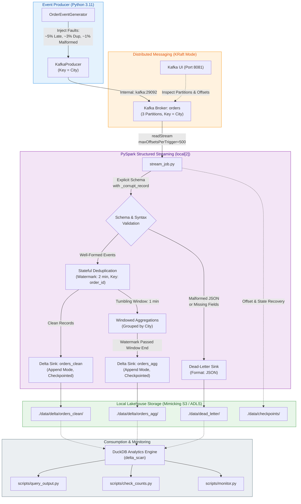

# Real-Time Orders Streaming Lakehouse (`realtime-orders-streaming`)

A production-grade, 100% local streaming pipeline processing simulated e-commerce and UPI order events. Built with **Apache Kafka (KRaft mode)**, **Apache Spark Structured Streaming (PySpark)**, **Delta Lake**, and **DuckDB**, orchestrated entirely within a single `docker-compose.yml`.

---

## Architecture Overview

---

## How It Runs Locally

Designed to run smoothly on standard laptops (e.g., 8 GB RAM, 4 CPU cores) with zero cloud dependencies:

| Container | Image | Purpose | Port / Resources |
| :--- | :--- | :--- | :--- |
| **`orders-kafka`** | `apache/kafka:3.7.1` | KRaft broker (no ZooKeeper), auto-creates topic `orders` with 3 partitions. Dual listeners. | `localhost:9092` (host), `kafka:29092` (internal) (~350 MB RAM) |
| **`orders-kafka-ui`**| `provectuslabs/kafka-ui:v0.7.2` | Web dashboard for inspecting topics, partitions, and live payloads. | [http://localhost:8081](http://localhost:8081) (~300 MB RAM) |
| **`orders-producer`**| `dataengineerproject2-producer` (Python 3.11-slim) | Generates UPI orders keyed by city with injected faults (~5% late, ~3% dup, ~1% malformed). | Internal (~20 MB RAM) |
| **`orders-spark`**   | `dataengineerproject2-spark` (Spark 3.5.1) | PySpark Structured Streaming engine in `local[2]` mode with Delta Lake 3.2.0. | Internal (~1.5 GB RAM) |

### Local Storage Layout (Standing in for S3 / ADLS)
All storage is mounted under `./data` on the host machine:
- `./data/delta/orders_clean/`: Bronze/Silver layer storing deduplicated, parsed valid orders in Delta format.
- `./data/delta/orders_agg/`: Gold layer storing 1-minute tumbling window metrics (revenue, order counts by status per city) in Delta format.
- `./data/dead_letter/`: Quarantined malformed or schema-violating payloads with diagnostic error reasons.
- `./data/checkpoints/`: Write-Ahead Log (WAL) and state stores for each streaming sink enabling fault-tolerant restart.

---

