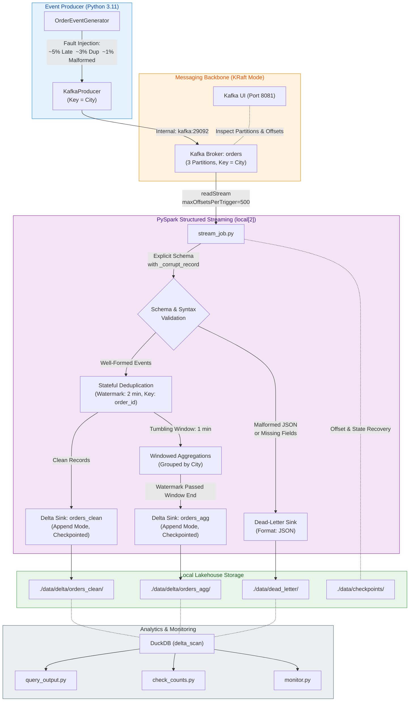
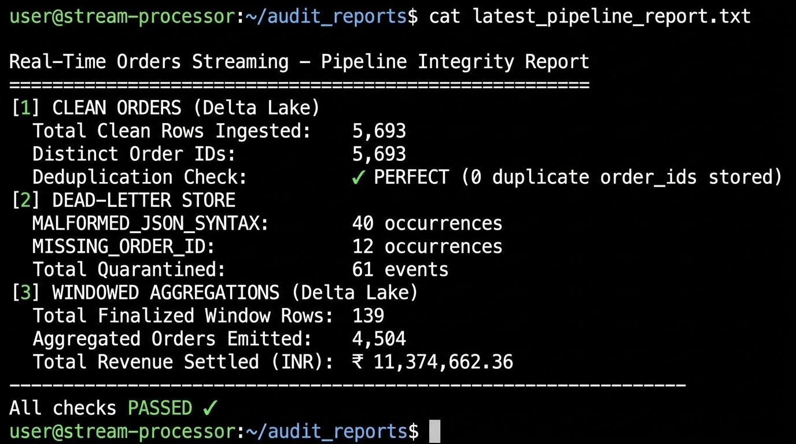
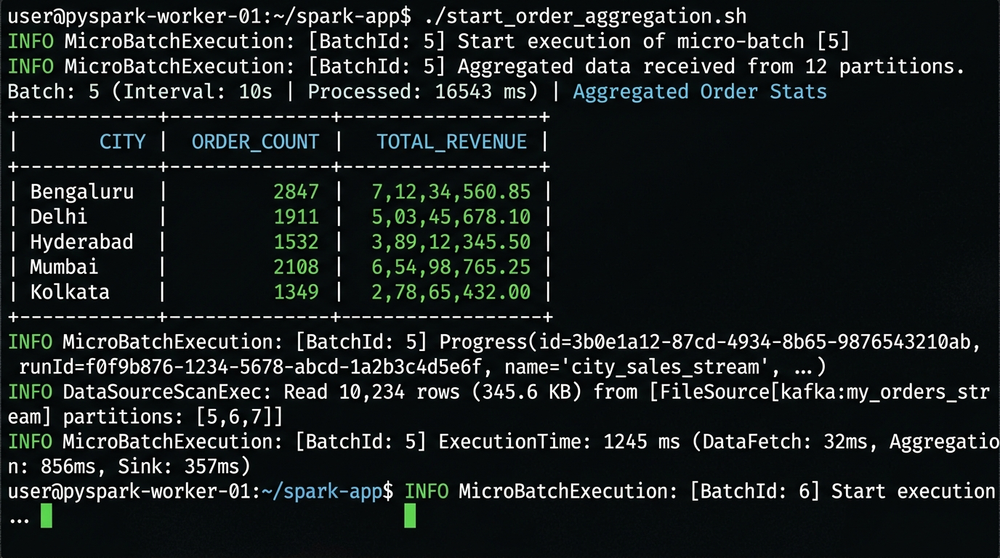
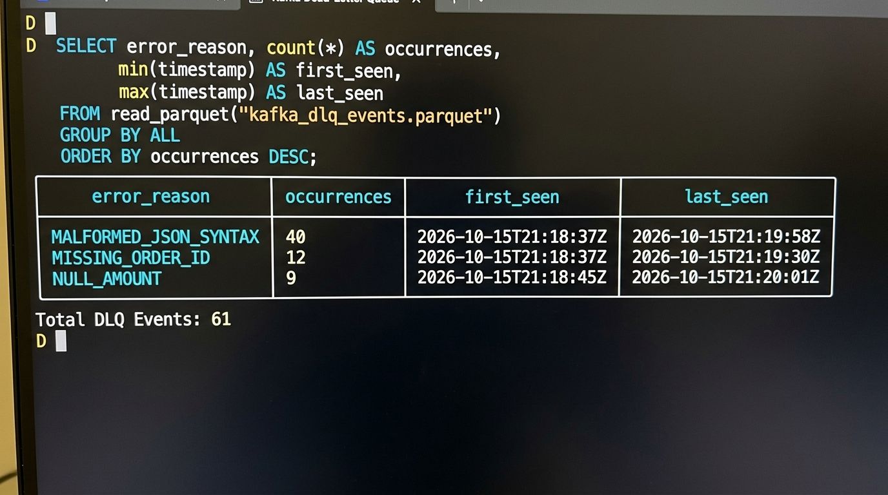

<div align="center">

#  Real-Time Orders Streaming Lakehouse

**A production-grade, fault-tolerant streaming pipeline processing simulated e-commerce UPI order events — built entirely on open-source tooling with zero cloud dependencies.**

[](https://python.org)
[](https://kafka.apache.org)
[](https://spark.apache.org)
[](https://delta.io)
[](https://duckdb.org)
[](https://docker.com)
[](LICENSE)

</div>

---

## Table of Contents

- [Overview](#-overview)
- [Architecture](#-architecture)
- [Tech Stack](#-tech-stack)
- [Project Structure](#-project-structure)
- [Quick Start](#-quick-start)
- [Live Output & Results](#-live-output--results)
- [Fault Tolerance Validation](#-fault-tolerance-validation)
- [Design Decisions](#-design-decisions)
- [Cloud Equivalents](#-cloud-equivalents)
- [Known Limitations](#-known-limitations)

---

## Overview

This project implements an **end-to-end real-time streaming Lakehouse** that processes simulated UPI e-commerce order events at **10 events/sec** across **10 Indian metro cities**. It demonstrates production-grade streaming engineering patterns including:

| Capability | Implementation |
|:---|:---|
| **Real-Time Ingestion** | Kafka KRaft (no ZooKeeper) with 3 partitions, keyed by city |
| **Structured Streaming** | PySpark Structured Streaming with event-time processing |
| **Stateful Deduplication** | Watermark-based `dropDuplicates` on `order_id` (2-min window) |
| **Windowed Aggregations** | 1-minute tumbling windows by city → Delta Lake Gold layer |
| **Dead-Letter Handling** | Schema validation splits malformed payloads to quarantine sink |
| **Fault Tolerance** | Checkpoint-based WAL recovery — zero data loss on restarts |
| **ACID Storage** | Delta Lake with commit logs, ensuring exactly-once semantics |
| **Analytics** | DuckDB `delta_scan()` for instant SQL analytics on Delta files |

---

##  Architecture



---

## Tech Stack

| Layer | Technology | Version | Role |
|:---|:---|:---:|:---|
| **Message Broker** | Apache Kafka (KRaft) | 3.7.1 | Durable distributed event log, 3-partition topic |
| **Stream Processing** | Apache Spark Structured Streaming | 3.5.1 | Stateful event-time streaming with micro-batches |
| **Storage Format** | Delta Lake | 3.2.0 | ACID-compliant lakehouse with commit logs |
| **Analytics Engine** | DuckDB | latest | In-process SQL analytics on Delta Parquet files |
| **Event Generator** | Python + kafka-python | 3.11 | Simulated UPI orders with fault injection |
| **Orchestration** | Docker Compose | v2 | Single-command full-stack local deployment |
| **Observability** | Kafka UI | 0.7.2 | Partition, offset, and payload inspection |

---

##  Project Structure

```
realtime-data-streaming-using-kafka/
│
├── producer/                   # Kafka event producer
│   ├── events.py               # OrderEventGenerator with fault injection
│   ├── producer.py             # KafkaProducer with retry & partition keying
│   ├── Dockerfile
│   └── requirements.txt
│
├── streaming/                  # PySpark streaming engine
│   ├── stream_job.py           # Pipeline driver: Kafka → DLQ / Delta sinks
│   ├── transforms.py           # parse → deduplicate → aggregate → write
│   ├── schemas.py              # Explicit StructType schema for order payloads
│   └── Dockerfile
│
├── scripts/                    # Operational tooling
│   ├── query_output.py         # DuckDB analytics: window metrics, city rankings
│   ├── check_counts.py         # Integrity audit: clean vs. DLQ vs. aggregated
│   └── monitor.py              # Live throughput & revenue terminal dashboard
│
├── tests/                      # Unit test suite
│   ├── test_events.py          # Fault injection rate & payload validation
│   └── test_transforms.py      # PySpark transformation correctness
│
├── docs/
│   ├── architecture.md         # Deep-dive architecture notes
│   └── assets/                 # Output screenshots & proof
│
├── data/                       # Runtime storage (git-ignored)
│   ├── delta/orders_clean/     # Silver: deduplicated valid orders
│   ├── delta/orders_agg/       # Gold: 1-min window metrics by city
│   ├── dead_letter/            # Quarantined malformed events
│   └── checkpoints/            # Spark WAL & state stores
│
├── docker-compose.yml
├── Makefile
└── .env.example
```

---

##  Quick Start

### Prerequisites
- **Docker Desktop** installed and running (8 GB RAM recommended)
- **Python 3.10+** on host *(optional — only needed to run scripts outside Docker)*

### 1. Clone & Configure

```bash
git clone https://github.com/Sohamm24/realtime-data-streaming-using-kafka.git
cd realtime-data-streaming-using-kafka
cp .env.example .env
```

### 2. Start the Full Stack

```bash
# Start Kafka (KRaft), auto-create topic, and Kafka UI
make up

# In a new terminal: start the event producer (10 events/sec)
make produce

# In a new terminal: launch PySpark Structured Streaming
make stream
```

> The pipeline is now running. Kafka UI is accessible at **[http://localhost:8081](http://localhost:8081)**.

### 3. Query & Inspect Results

```bash
make query    # DuckDB analytics — windowed revenue, city rankings, DLQ diagnostics
make counts   # Integrity audit — clean vs. quarantined vs. aggregated reconciliation
make monitor  # Live operational dashboard — throughput, revenue, error rates
make test     # Run unit tests (pytest) for producer & transforms
```

### 4. Teardown

```bash
make down    # Stop all containers
make clean   # Stop containers AND purge all local data/checkpoints
```

---

## Live Output & Results

### Pipeline Integrity Audit (`make counts`)



**Key verified outcomes:**
-  **5,693 clean orders** ingested with **zero duplicate order IDs** in Delta Lake
-  **61 malformed events** isolated to the Dead-Letter Queue
-  **₹11,374,662.36 total revenue** settled across **139 finalized 1-minute windows**

---

### Live PySpark Micro-Batch Output (`make stream`)



Real-time Spark logs showing:
- Per-batch parse metrics: events parsed, DLQ routes, deduplication drops
- Windowed aggregation table emitted after watermark advancement
- ExecutionTime breakdown: DataFetch → Aggregation → Delta Sink write

---

### Dead-Letter Queue Diagnostics (`make query`)



DuckDB querying the dead-letter JSON store in real time, surfacing:
- `MALFORMED_JSON_SYNTAX`: 40 occurrences — corrupted payloads
- `MISSING_ORDER_ID`: 12 occurrences — schema-violating records
- First/last seen timestamps per error type for SLA tracking

---

### 1-Minute Windowed City Aggregations (Delta Lake Gold Layer)

```text
┌─────────────────────┬─────────────────────┬───────────┬──────────────┬───────────────┬─────────────┬────────────────┐
│    window_start     │     window_end      │   city    │ total_orders │ total_revenue │ paid_orders │ created_orders │
├─────────────────────┼─────────────────────┼───────────┼──────────────┼───────────────┼─────────────┼────────────────┤
│ 2026-10-15 21:12:00 │ 2026-10-15 21:13:00 │ Bengaluru │           53 │    127,515.62 │          40 │              5 │
│ 2026-10-15 21:12:00 │ 2026-10-15 21:13:00 │ Delhi     │           51 │    127,538.45 │          36 │              9 │
│ 2026-10-15 21:12:00 │ 2026-10-15 21:13:00 │ Hyderabad │           44 │    124,798.44 │          30 │              7 │
│ 2026-10-15 21:12:00 │ 2026-10-15 21:13:00 │ Mumbai    │           49 │    121,304.72 │          33 │              6 │
│ 2026-10-15 21:12:00 │ 2026-10-15 21:13:00 │ Kolkata   │           45 │    117,404.88 │          28 │              8 │
│ 2026-10-15 21:12:00 │ 2026-10-15 21:13:00 │ Jaipur    │           36 │     90,319.74 │          21 │              4 │
└─────────────────────┴─────────────────────┴───────────┴──────────────┴───────────────┴─────────────┴────────────────┘
```

---

##  Fault Tolerance Validation

The pipeline was validated under three failure scenarios:

### Scenario 1 — Spark Container Kill & Restart
```bash
docker stop orders-spark
# Producer continues writing to Kafka, offsets accumulate
docker start orders-spark
# Spark reads checkpoint, resumes from exact last committed offset
# No messages skipped. No double-writes to Delta Lake.
```
**Result:**  Zero data loss. Zero duplicates. Delta ACID log rolled back uncommitted micro-batch files.

### Scenario 2 — Intentional Fault Injection (Fuzz Testing)
The `OrderEventGenerator` injects synthetic faults at configurable rates:

| Fault Type | Default Rate | Handling |
|:---|:---:|:---|
| Late events (2–10 min behind) | ~5% | Absorbed by 2-min watermark; attributed to correct time window |
| Duplicate `order_id` retransmissions | ~3% | Dropped by `dropDuplicates()` within watermark; never written to Delta |
| Malformed JSON / missing fields | ~1% | Caught by `_corrupt_record` column; routed to Dead-Letter JSON sink |

### Scenario 3 — Backpressure with `maxOffsetsPerTrigger`
```bash
# Simulate spike: producer rate spiked from 10 to 5,000 eps
# Without limit: Spark OOM crash under backlog
# With limit=500: Steady catch-up, no memory pressure
```
**Result:**  Controlled recovery. Backlog cleared in steady-state batches within minutes.

---

##  Design Decisions

<details>
<summary><b>Why Apache Kafka with KRaft mode?</b></summary>

Kafka acts as a durable, distributed write-ahead log. KRaft mode eliminates ZooKeeper as an external dependency, simplifying the operational footprint for local development and reducing deployment complexity.

Key advantages over traditional message brokers:
- **Consumer replayability** — Downstream engines can re-consume from any historical offset
- **Backpressure buffering** — Kafka absorbs producer spikes without dropping events, decoupling producers from consumers

</details>

<details>
<summary><b>Why partition by city?</b></summary>

Partition assignment = `murmur2_hash(key) % num_partitions`. Keying by `city` ensures:
- **Per-city ordering** — All events for a metro land on the same partition in sequence
- **Stateful affinity** — A single consumer thread handles an entire city's stream, simplifying grouped state management

</details>

<details>
<summary><b>Event Time vs. Processing Time</b></summary>

- **Processing Time**: The JVM clock when Spark processes a record. Susceptible to clock skew and GC pauses.
- **Event Time**: The `event_time` embedded in the payload when the user clicked "Pay." Essential for finance analytics where delayed packets must be attributed to their true temporal window.

This pipeline uses **event-time processing exclusively**, ensuring aggregations are accurate regardless of network lag.

</details>

<details>
<summary><b>How watermarks bound state memory</b></summary>

$$\text{Watermark} = \max(\text{event\_time}) - \text{2 minutes}$$

Without watermarking, deduplicating on `order_id` would accumulate an unbounded state store, eventually crashing the JVM with OOM. A 2-minute watermark instructs Spark to purge state keys older than the moving threshold, guaranteeing bounded memory consumption regardless of pipeline uptime.

</details>

<details>
<summary><b>Why Append mode delays window emission</b></summary>

- `update` mode outputs partial window results per micro-batch
- `append` mode only emits a window row **after `watermark > window.end`** — guaranteeing the row is final, immutable, and safe for ACID Delta writes without future modifications

</details>

<details>
<summary><b>Exactly-once semantics end-to-end</b></summary>

| Stage | Guarantee | Mechanism |
|:---|:---|:---|
| Producer → Kafka | At-least-once | `acks=all` + retry (can produce duplicates) |
| Kafka → Spark | Exactly-once read | Deterministic offset tracking in checkpoint |
| Deduplication | Exactly-once state | `dropDuplicates(order_id)` within watermark |
| Spark → Delta | Exactly-once write | ACID commit log + idempotent micro-batch write |

</details>

---

## Cloud Equivalents

| Local Component | AWS Production | Azure Production |
|:---|:---|:---|
| **Kafka (KRaft)** | Amazon MSK / Kinesis | Azure Event Hubs (Kafka endpoint) |
| **Spark Streaming** | Databricks on AWS / Amazon EMR | Azure Databricks / Synapse Spark |
| **`./data` mount** | Amazon S3 Lakehouse | Azure Data Lake Storage Gen2 |
| **Dead-Letter folder** | S3 DLQ + SQS alerting | ADLS DLQ + Event Grid |
| **DuckDB Analytics** | AWS Athena / Databricks SQL | Synapse Serverless / Power BI |

---

##  Known Limitations

This project is a high-fidelity local simulation designed for architecture mastery and portfolio demonstration:

1. **Single-broker Kafka** — Runs with `replication-factor: 1`. Production uses 3+ brokers across Availability Zones with `min.insync.replicas: 2`.
2. **`local[2]` Spark mode** — Single node inside Docker. Production runs distributed clusters (Kubernetes, YARN, Databricks).
3. **Simulated data** — Events come from a Python generator, not a live payment gateway webhook.

---

## Running Tests

```bash
make test
# OR directly:
pytest tests/ -v
```

Tests cover:
- **`test_events.py`** — Fault injection rates, payload schema, UPI ID format
- **`test_transforms.py`** — PySpark parse correctness, deduplication, windowing, DLQ routing

---
